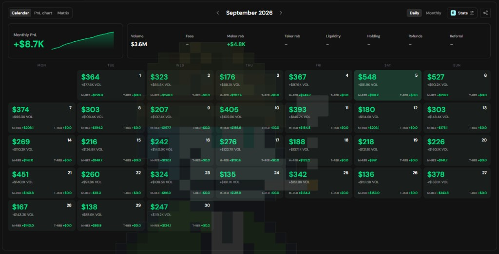
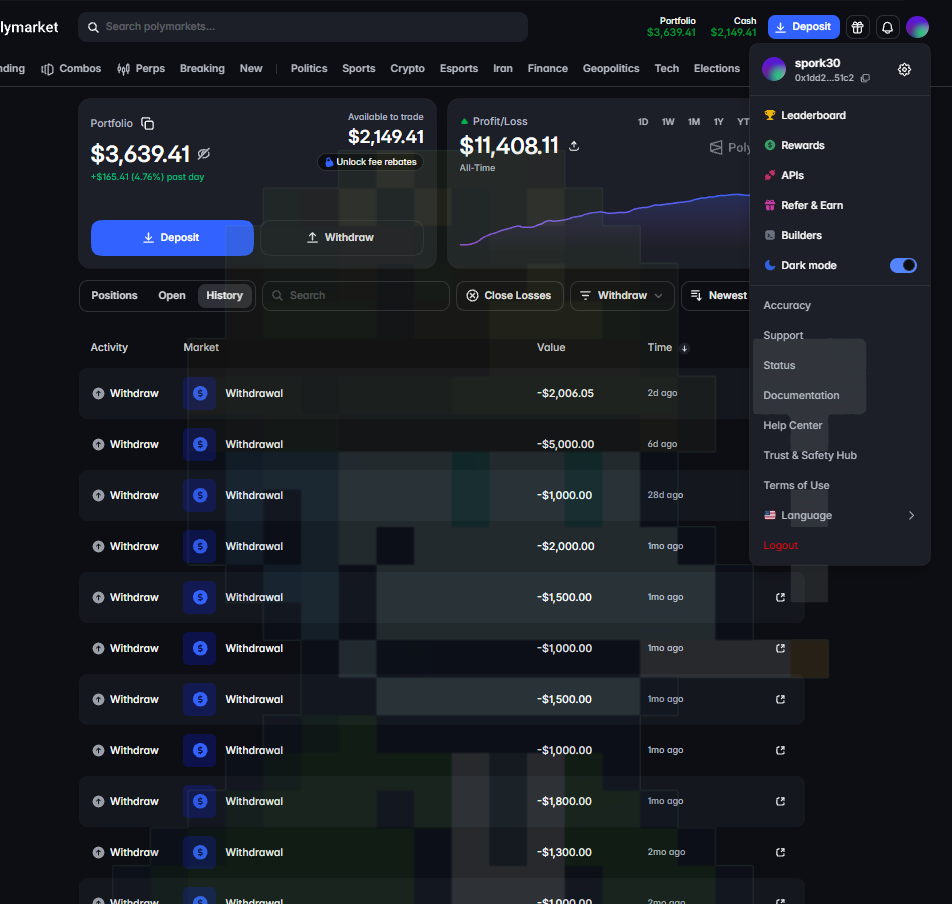
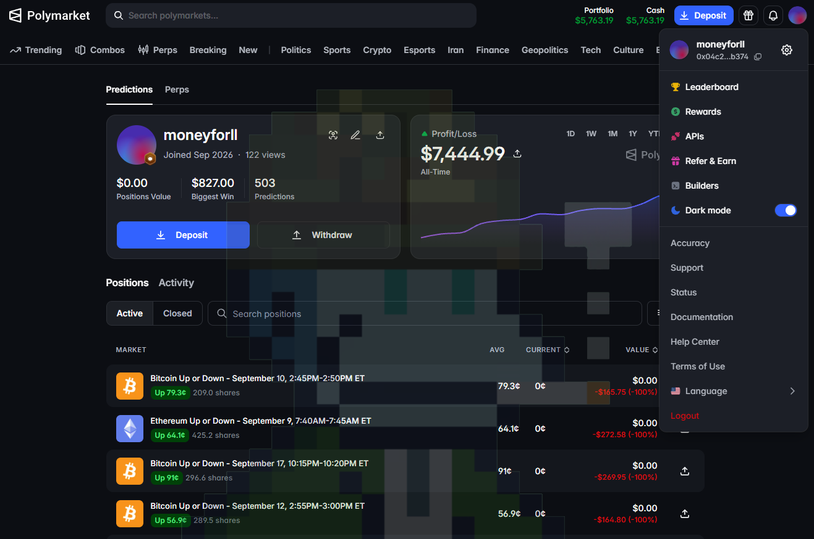
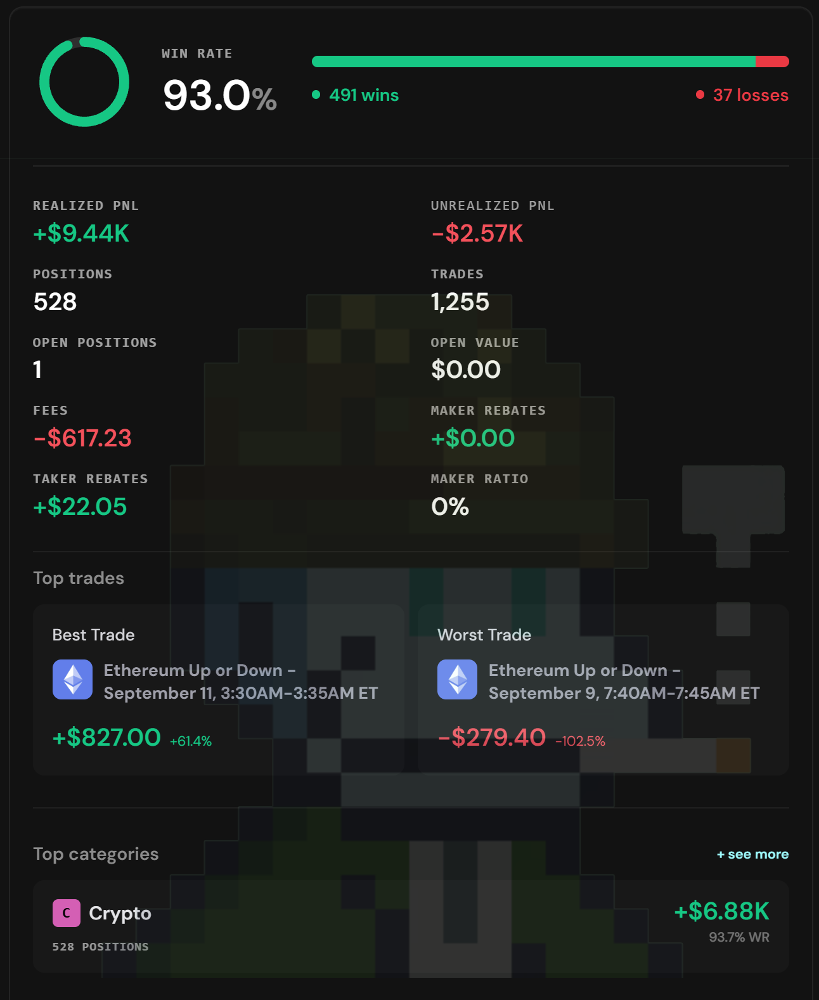
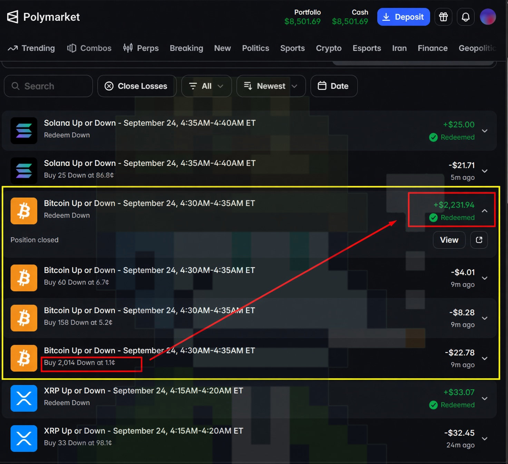
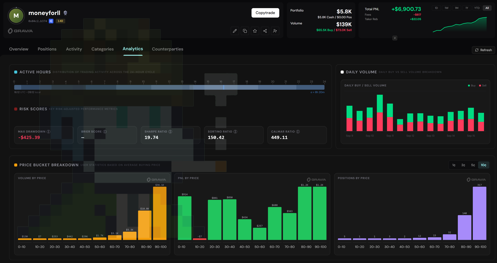

# Polymarket Trading Strategies

Systematic strategies running on the current **TWAP edition**. This document is a research journal: market condition, signal, entry, execution, edge, and risk — not a software manual.

`Polymarket` · `Algorithmic Trading` · `Quantitative Strategies` · `TWAP Edition`

Questions or support:

---

## Strategy Philosophy

Polymarket is not only about predicting the outcome. Short-window markets have **microstructure**: liquidity, timing, order-book lag, and brief dislocations around shocks and cycle boundaries.

These strategies trade **observable market behavior**, not a narrative view on Bitcoin. A condition has to be present in price, book, and remaining time before size is taken.

---

## Strategy Overview

| Strategy | Core Idea | Market Condition | Status |
| --- | --- | --- | --- |
| Market Maker (Splits + Sell) | Split a complete set, then sell the tokens into the book | Two-sided book; inventory comes from the split, not from a take | Live |
| TWAP-Aware EndCycle Sniper | Buy the late-cycle favorite along its time-weighted path while it still trades below $1 | Short-window market near expiry; one side dominating | Popular — Available for Sale |
| Additional strategies | Documented as they are introduced | — | Planned |

Live profiles are linked in each section. Displayed account figures are UI snapshots, not a verified track record.

---

## Market Maker — Splits + Sell

Polymarket profile: [spork30](https://polymarket.com/@spork30)

**First market-maker version: split a complete set into inventory, then sell it into the book. Live since 23 July.**

### The Idea

This version does not lift a favorite. It **splits** collateral into a complete outcome set — both tokens, at $1 for the pair — and then **sells** those tokens into the book.

The split is the inventory. The sell is the quote. If both sides sell for more than the $1 that minted them, the difference is the spread. Maker rebates pay on the posted size. A token that does not sell is inventory into settlement, not a missed click.

This version has been running since **23 July**. September is one full month of that record.

### How the Trade Works

1. Split collateral into both outcome tokens.
2. Offer those tokens on the book. The account is the maker.
3. Sell the pair for more than $1 when the book pays the spread.
4. Hold whatever does not sell through resolution.
5. Collect maker rebates on the posted volume. Taker flow is not the business.

### Visual Example

  

**Example:** September 2026 calendar for [spork30](https://polymarket.com/@spork30).

- Monthly PnL **+$8.7K** on **$3.6M** of volume. Maker rebates **+$4.8K**. Fees, liquidity, holding, refunds, and referral are blank on this panel.
- Every displayed day is green, from **$135** on the 24th to **$548** on the 5th. The month is a sequence of small daily results, not one settlement.
- Each day prints a maker rebate and **taker rebates of $0.00**. The account is posting, not lifting.
- Volume stays large beside the daily PnL (`$77.5K` on the 1st, `$151.2K` on the 26th, `$119.2K` on the 30th). That is a spread business: a thin result on a lot of size.

  

**Example:** Polymarket profile for the same account, history filtered to withdrawals.

- All-time profit/loss **$11,408.11**. Portfolio **$3,639.41**, available to trade **$2,149.41**, past day **+$165.41** (**4.76%**).
- The history is cash leaving the account: **$5,000.00**, **$2,006.05**, **$2,000.00**, **$1,800.00**, **$1,500.00**, **$1,300.00**, and **$1,000.00** clips. The list continues past the frame. These rows are withdrawals, not trades.
- The all-time curve is the path since the bot started on **23 July**. September’s **+$8.7K** is one month inside that figure, not the whole of it.

### Where the Edge Comes From

A complete set costs $1 to mint. The book does not always buy both sides back at a combined $1. Quoting the split, and getting paid maker rebates for the size that trades, is the candidate edge.

September puts numbers on that. **$3.6M** of volume, **+$8.7K** of monthly PnL, **+$4.8K** of maker rebates, and **$0.00** taker rebates on the displayed days. The rebate line is a large part of what the panel shows. The trading line is the rest. Once the pair sells for $1 or less, or one side is left unsold into a move, the spread is gone.

### Risk

- One side can sell and the other can remain. The unsold token settles at $1 or at $0.
- A quoted price can be picked off when the underlying moves. Maker inventory is directional the moment it is no longer a pair.
- The margin is thin. **+$8.7K** on **$3.6M** of volume does not survive a bad inventory day, a fee change, or a run of one-sided fills.
- Withdrawals on the profile are not a return. They are cash already taken out.
- Displayed calendar and profile figures are UI snapshots, not a verified track record.

---

## TWAP-Aware Polymarket EndCycle Sniper (Popular — Available for Sale)

Polymarket profile: [moneyforll](https://polymarket.com/@moneyforll?tab=activity)

### The Idea

In short-cycle Up or Down markets, uncertainty compresses as the clock runs out. One side becomes the favorite while the book can still quote it below $1.

This version is **TWAP-aware**. The favorite is a path through the window, and the decision uses the time-weighted price of that path: where the side has traded, where it is offered now, and how much time is left. Size is taken in clips while the average entry still sits inside the gap to settlement.

The trade is late-cycle execution. If the path has already closed on $1, or the book cannot fill the average the clock allows, there is no trade.

### How the Trade Works

1. Monitor the active short-cycle market as it approaches the end of its window.
2. Read which outcome is dominating, the path that side has printed, and how much size is on the book.
3. Compare the time-weighted price of the favorite with the live quote and the time remaining.
4. Lift the favored side in clips while that average still clears the remaining gap.
5. Hold through resolution and redeem if the market settles in-the-money.

### Visual Example

  
  

**Example:** Polymarket profile [moneyforll](https://polymarket.com/@moneyforll?tab=activity), with the performance panel beside it.

- Profile profit/loss reads **$7,444.99**. The curve is the account’s displayed path. **503** predictions, biggest win **$827.00**, positions value **$0.00**. Joined Sep 2026, **122** views on this snapshot.
- Win rate **93.0%**: **491** wins and **37** losses, on **528** positions and **1,255** trades.
- Realized PnL **+$9.44K**, unrealized PnL **-$2.57K**, open positions **1**, open value **$0.00**. This panel is a separate display from the Polymarket all-time figure.
- Fees **-$617.23**, taker rebates **+$22.05**, maker rebates **$0.00**, maker ratio **0%**. The account takes liquidity.
- Best trade on the panel: **Ethereum Up or Down — September 11, 3:30AM–3:35AM ET**, **+$827.00** (**+614%**). A gain of that size is a low entry that settled at $1. A fill in the 90¢ band redeems closer to an 11% gap.
- Worst trade on the panel: **Ethereum Up or Down — September 9, 7:40AM–7:45AM ET**, **-$279.40** (**-102.5%**). The favorite-side read can still finish at zero on a 5-minute window.

  

**Example:** A 1¢ snipe in Bitcoin Up or Down — September 24, 4:30AM–4:35AM ET. The highlighted fill is the edge: the token is still offered near 1¢, and the account takes size there.

- The same 5-minute window shows three Down clips: **60 at 6.7¢** (**-$4.01**), **158 at 5.2¢** (**-$8.28**), and **2,014 at 1.1¢** (**-$22.78**).
- The 1.1¢ print is the snipe. **2,014 shares for $22.78** is a token quoted at about a cent, not a favorite already marked near $1.
- That window then shows **Redeem Down +$2,231.94**. The three clips are **2,232** shares, and the redeem is about **$1 per share** on that inventory. Most of those shares were bought at **1.1¢**.
- This is one settled window. The green figure is the redeem, not a strategy-level return.

  

**Example:** Price buckets, active hours, and risk scores for the same account.

- Positions concentrate in the favorite band: **251** in **90–100¢** and **143** in **80–90¢**.
- Volume has the same shape. The **90–100¢** bucket is the bulk of traded size.
- PnL is green across nearly every decile, with the larger bars in the upper price buckets. Displayed profit is many small gaps to $1, repeated. The **+614%** line is a separate extreme on the performance panel.
- Activity is spread across the 24-hour cycle. The panel’s own spread mark is **8h 20m**.
- Max drawdown **-$425.39**. Brier score is blank.
- Sharpe **19.74**, Sortino **150.42**, Calmar **449.11**. These are the figures printed on the panel for this sample, beside a **-$425.39** drawdown and a **-$279.40** worst trade.

### Where the Edge Comes From

Short-horizon binaries reprice into the close. One outcome takes the probability, and the book can still offer it below 100¢. The offer can also jump once the book thins.

The candidate edge is the distance between the favorite’s time-weighted path and $1, provided the clips fill while that average is still short of settlement. TWAP-aware execution tries to own that path. Once the path has reached $1, or the takes walk through the gap, the window has nothing left to pay.

The same clock can leave the other token offered near **1¢**. In the September 24, 4:30–4:35 AM ET Bitcoin window, Down was still available at **1.1¢** in size: **2,014 shares for $22.78**. Down then redeemed for **$2,231.94**. The edge in that frame is sniping the token at about a cent before the book stops offering it.

### Risk

- The favorite can reverse in the last seconds. The panel’s **37** losses are that case.
- A 1¢ token that does not settle pays zero. The September 24 clip risked **$22.78** to own 2,014 shares; the misses are not in that screenshot.
- Late books are thin: partial clips, slippage, quotes that update late.
- Clips paced too slowly leave size unfilled when the window ends.
- Clips paced too quickly pay the final ask and give the gap back.
- The underlying print can disagree with the side the book is treating as the favorite.
- Losses on a high-priced favorite are a large fraction of premium. The worst displayed ETH window is **-$279.40**.
- Sharpe, Sortino, and Calmar here are panel outputs on a short public history (joined Sep 2026). Read them with the drawdown.

---

## More Strategies Coming

These are the strategies being introduced publicly.

Additional strategies are running in the broader TWAP system and will be documented the same way: condition, signal, execution, edge, risk — with live-market examples.

- Strategy 03 — Coming soon
- Strategy 04 — Coming soon
- Strategy 05 — Coming soon

---

## What These Strategies Have in Common

- React to **market structure**, not a story about the event.
- Require a **specific condition** before size: a late clock for the sniper, a book that can be quoted for the maker.
- Treat **execution** as part of the strategy: time remaining, size on the book, fill quality.
- Separate **signal** from **trade** — seeing a move is not the same as having a fill.
- Look for **repeatable behavior** in short-cycle BTC Up/Down markets, not isolated wins.

---

## Educational Takeaway

Systematic trading here is less about calling every market correctly and more about finding **repeatable conditions** where timing, liquidity, and payoff can produce a favorable expected outcome — and where they cannot.

Useful things to study on Polymarket short-cycle markets:

- Price path inside the window, not just the final result
- Liquidity and apparent order-book depth at the moment of the signal
- Time remaining versus how far the quote still sits from $0 or $1
- Whether both legs still add up in a way that makes sense
- Fill quality: average price, size received, delay to click or send
- Position-level risk: what the tape costs if the other side settles

Screenshots show **one path** through a market. They do not show the trades that did not work.

---

## Disclaimer

This README is educational and research material. It describes how these strategies think about Polymarket microstructure. It is not an offer, a performance record, or advice to trade.

Historical or displayed trades do not imply future results. Prediction-market trading involves risk, including full loss of capital. Market rules, resolution, liquidity, and fees should be verified independently before any trading decision.

---

## Contact

Questions or support:

- **Telegram** — [@soulcrancerdev](https://t.me/soulcrancerdev)
- **Community** — [Telegram group](https://t.me/+SxEC7bVXYyphNzI5)
- **X** — [@soulcrancerdev](https://x.com/soulcrancerdev)
- **YouTube** — [@soulcrancerdev](https://youtube.com/@soulcrancerdev)
